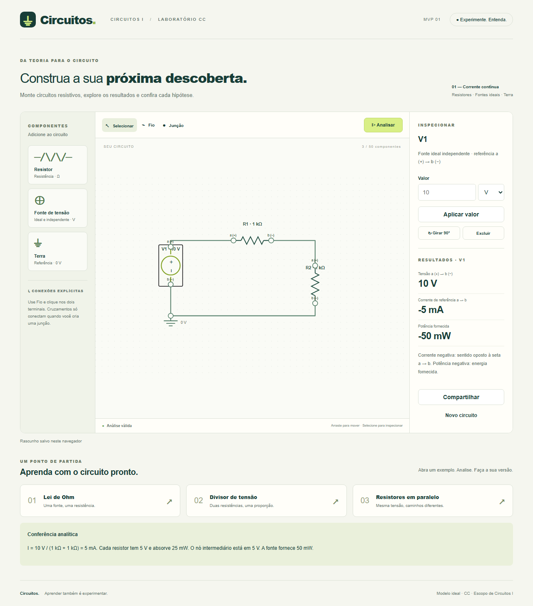

# Circuitos.

Laboratório web educacional para Circuitos I. Monte circuitos resistivos em corrente contínua,
analise tensões, correntes e potências e compartilhe uma versão por link, sem login.



## Executar

Requer Node.js 24 e npm. Na raiz:

```sh
npm ci
npm run dev
```

Abra http://localhost:3000. Para conferir o artefato de produção:

```sh
npm run build
npm run preview
```

Abra http://localhost:4173. O build gera `out/`, sem servidor de aplicação ou banco.

## Primeiro circuito

1. Abra **Divisor de tensão** e pressione **Analisar**.
2. Selecione R1: 5 V, 5 mA e 25 mW. A fonte mostra -5 mA e -50 mW.
3. Selecione um terminal ou fio para consultar a tensão do nó em relação ao terra.
4. Use **Compartilhar** para gerar um link de leitura. **Criar cópia para editar** mantém
   a versão original intacta.

Para montar do zero, adicione resistor, fonte e terra pela paleta. Em **Fio**, clique no
terminal inicial e final. Clique em um fio para conectar explicitamente a um ponto dele.
**Junção** une explicitamente fios no ponto escolhido; cruzamentos comuns não se conectam.
Arraste o corpo para mover e use o painel para girar, editar valores ou excluir.
Esc cancela uma operação em andamento. Excluir componente ou junção remove fios incidentes.

## Convenções e escopo

- Resistores lineares positivos, fios ideais e fontes ideais independentes de tensão CC.
- Terminais a (+), b (−); tensão V(a)−V(b), corrente a→b e potência p=v·i.
- Corrente negativa se opõe à referência. Potência positiva é absorvida; negativa, fornecida.
- Todos os símbolos de terra representam o mesmo nó de 0 V. Terminais abertos impedem análise
  por uma regra didática deste MVP, mesmo quando o circuito físico poderia ter solução.
- Toda edição invalida resultados, inclusive mover/girar; selecionar não invalida.
- Limites: 50 componentes, 100 nós, 20 terras, 300 fios, 200 junções e 8 bends por fio.
- Sem login, colaboração, CA, capacitores, indutores, fontes de corrente, desfazer ou exportação.
  Inglês e internacionalização são uma evolução posterior ao MVP.

O último rascunho é salvo neste navegador/origem. Reabrir exige nova análise. Apagar dados
do navegador remove o rascunho. Falhas de armazenamento são informadas; não há sincronização.
Links carregam um snapshot comprimido, não dependem da sessão do autor, são acessíveis a quem
os possui e não provam autoria. Há limite de 64000 caracteres e 256 KiB descomprimidos;
mensageiros podem cortar URLs longas. Resultados recebidos são recalculados antes da exibição.

## Arquitetura

Next.js/React/TypeScript com exportação estática e SVG nativo. O motor puro em `src/engine/`
usa análise nodal modificada, LU e SVD; não depende de canvas, React ou browser.
`src/domain/` deriva conectividade por referências explícitas. Editor e persistência são
adaptadores. O codec valida schema, tamanho e resultados dos links antes de mostrá-los.

Para manter o MVP em um pacote, a coordenação de persistência, diálogos e exemplos está
consolidada em `src/ui/Editor.tsx`, e os comandos de fios em `src/editor/commands.ts`.
Esses comportamentos correspondem às tarefas mesmo quando o arquivo proposto foi consolidado.

## Validar

```sh
npm run typecheck
npm run lint
npm test
npx playwright install
npm run build
npm run test:e2e
```

Vitest verifica motor, topologia, edição, rascunho e links. Playwright verifica o export estático
em Chromium, Firefox e WebKit. Em Linux CI, use `npx playwright install --with-deps`.
Veja [evidências e pendências](docs/validation/release.md). Aprovação automática não substitui
a avaliação com estudantes nem a verificação da aplicação publicada.

## Publicação

Siga [docs/deploy.md](docs/deploy.md) para Vercel, testes públicos e rollback.
A URL pública será registrada após a publicação verificada; não há uma URL de produção
validada neste estado do projeto.

## Contribuir e licença

Leia [CONTRIBUTING.md](CONTRIBUTING.md). Licença [MIT](LICENSE).
As decisões, contratos e tarefas ficam versionados em `specs/001-simulador-circuitos-cc/`.
